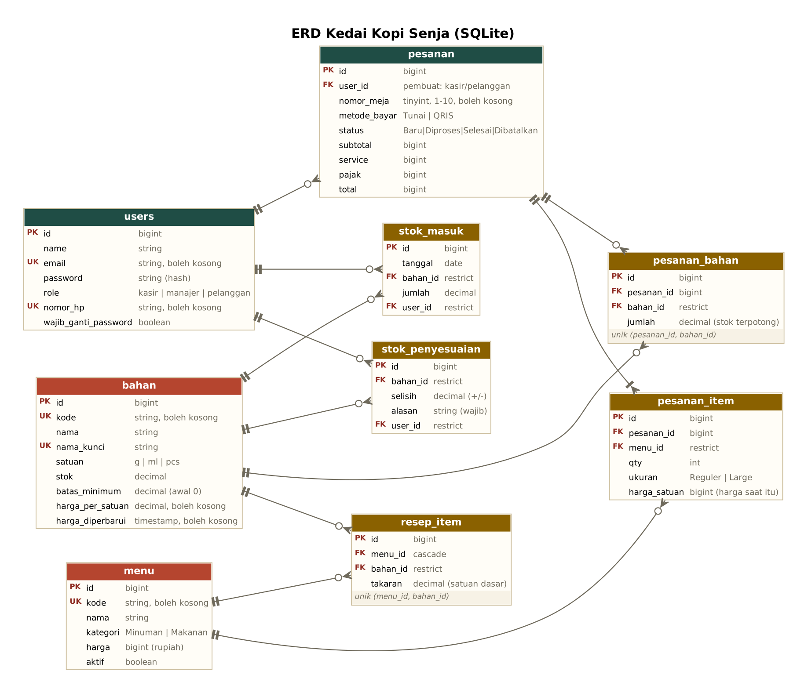
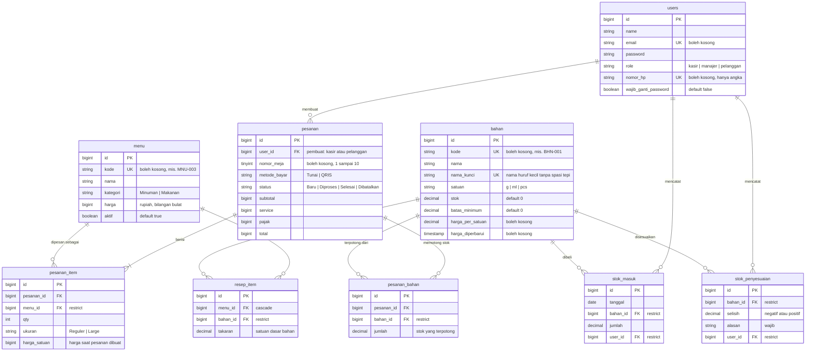

# ERD — Kedai Kopi Senja

Database: SQLite (relasional). Sumber kebenarannya adalah folder `database/migrations`.

Versi teks (Mermaid, tampil otomatis di GitHub):

Semua tabel juga memiliki `created_at` dan `updated_at`. Tabel Sanctum `personal_access_tokens` (token API) dan tabel
bawaan Laravel (`cache`, `jobs`, `sessions`, dan lain-lain) tidak digambar.

## Constraint penting

| Tabel | Constraint | Alasan |
|---|---|---|
| `bahan` | `nama_kunci` unik | Nama bahan tidak boleh ganda; beda huruf besar/kecil atau spasi tepi dianggap sama. |
| `users` | `nomor_hp` unik | Satu nomor HP hanya untuk satu akun pelanggan. |
| `resep_item` | unik (`menu_id`, `bahan_id`) | Satu bahan hanya satu baris dalam resep satu menu. |
| `pesanan_bahan` | unik (`pesanan_id`, `bahan_id`) | Kebutuhan bahan digabung per pesanan, satu baris per bahan. |
| `resep_item.menu_id` | `cascade` | Resep tidak berarti tanpa menunya. |
| Foreign key lain | `restrict` | Riwayat pembelian, struk, laporan, dan penyesuaian tidak hilang karena penghapusan data induk. |

## Catatan desain

- Uang disimpan sebagai bilangan bulat (rupiah), bukan desimal, supaya tidak ada selisih pembulatan.
- `pesanan_item.harga_satuan` dan angka di `pesanan` (subtotal, service, pajak, total) dibekukan saat pesanan dibuat,
  sehingga struk dan laporan lama tidak berubah ketika harga menu diubah.
- Status "Habis" pada menu tidak disimpan. Nilainya dihitung dari stok bahan setiap kali dibutuhkan.
- `pesanan_bahan` mencatat stok yang benar-benar terpotong, dipakai untuk mengembalikan persis jumlah itu saat
  pesanan dibatalkan.
- Harga bahan tidak diinput manual: berasal dari CSV (awal) lalu diperbarui dari layanan Supplier.

## Hubungan dengan rancangan awal (class diagram di PDF)

| Rancangan awal | Tabel di sistem |
|---|---|
| `User` | `users` |
| `Order` | `pesanan` |
| `OrderDetail` | `pesanan_item` |
| `Menu` | `menu` |
| `Recipe` + `RecipeDetail` | `resep_item` |
| `Ingredient` | `bahan` |
| `StockPurchase` + `StockPurchaseDetail` | `stok_masuk` |
| (tidak ada) | `pesanan_bahan`, `stok_penyesuaian` |

Alasan perbedaan dicatat di `docs/perancangan.md` bagian 2.
