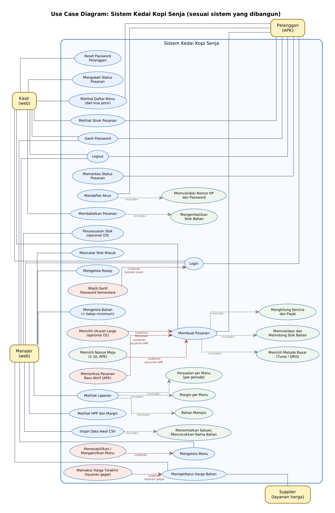
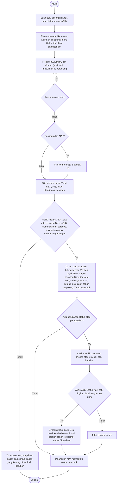
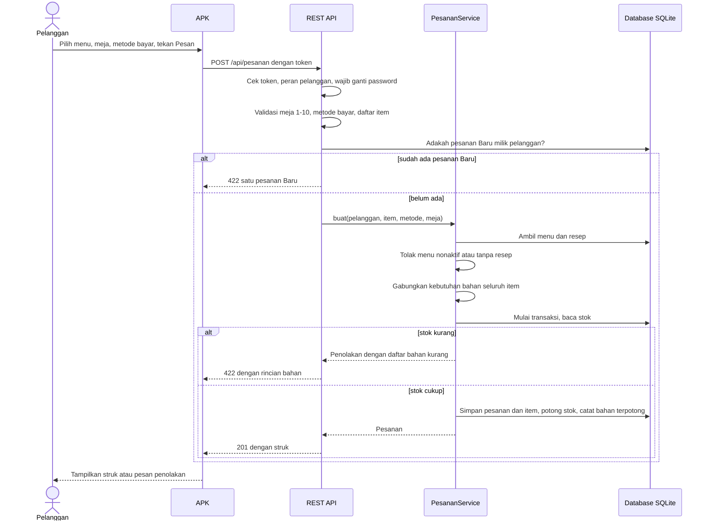

# Perancangan Sistem — Kedai Kopi Senja

Dokumen ini menyelaraskan **rancangan awal** (use case diagram, class diagram, activity diagram, skenario use case,
dan wireframe) dengan **sistem yang sudah dibangun**. Rancangan dibuat sebelum implementasi; selama pembangunan ada
penyesuaian, dan semua perbedaannya dicatat di bagian 2 beserta alasannya.

Daftar isi: 1 Aktor dan peran · 2 Ringkasan revisi · 3 Use case diagram · 4 Skenario use case · 5 Activity diagram ·
6 Diagram urutan · 7 Matriks hak akses · 8 Endpoint API · 9 Aturan soal dan letak kodenya · 10 Perbedaan wireframe ·
11 Hal yang diverifikasi

## 1. Aktor dan peran

| Aktor | Antarmuka | Tugas |
|---|---|---|
| Kasir | Web desktop | Membuat pesanan, mengubah status, membatalkan pesanan, melihat daftar menu, mereset password pelanggan |
| Manajer | Web desktop | Mengelola bahan, menu, resep, batas minimum, stok masuk, penyesuaian stok, melihat HPP dan laporan, impor CSV |
| Pelanggan | APK Android | Mendaftar, login, memesan dengan nomor meja, memantau status dan struk pesanannya sendiri |
| Supplier | Layanan HTTP | Menyediakan harga terbaru bahan (dipanggil dari server, bukan dari APK) |

## 2. Ringkasan revisi (rancangan awal → sistem jadi)

| No | Bagian | Rancangan awal | Sistem yang dibangun | Alasan |
|---|---|---|---|---|
| 1 | **Waktu stok dipotong** | Skenario SC-05: "stok belum dipotong" | **Stok dipotong saat pesanan dibuat** (dalam satu transaksi) | Aturan soal; activity diagram AD-01 dan use case "Memvalidasi dan Memotong Stok" sudah demikian, jadi skenario SC-05 dikoreksi |
| 2 | Login staf | `username` | **Email** | Keputusan: memakai kolom email bawaan Laravel (boleh kosong untuk pelanggan) |
| 3 | Resep | `Recipe` + `RecipeDetail` | Satu tabel `resep_item` (menu, bahan, takaran); resep = kumpulan baris milik satu menu | Tidak ada data lain di header resep; unik (`menu_id`, `bahan_id`) menggantikan "1 resep per menu" |
| 4 | Pembelian bahan | `StockPurchase` + `StockPurchaseDetail` | Satu tabel `stok_masuk` | Soal: pembelian = tanggal, bahan, jumlah; satu baris satu bahan |
| 5 | Catatan bahan terpotong | tidak ada | Tabel `pesanan_bahan` | Pengembalian stok saat batal harus persis sama dengan yang dipotong (resep bisa berubah) |
| 6 | Status pesanan | Baru, Diproses, Selesai | + **Dibatalkan** | Pesanan batal tidak dihapus (jejak, struk); tidak dihitung di laporan |
| 7 | Menu | `description`, `canOrder()`, `deactivate()` | Tanpa deskripsi; kolom `kode`; kategori **Minuman/Makanan**; aturan "bisa dipesan" ada di `PesananService` | Data klien memakai Minuman/Makanan; satu tempat untuk aturan pesanan |
| 8 | Bahan | tanpa kode | + `kode` (BHN-xxx) dan `nama_kunci` (unik) | Pencocokan impor dan Supplier; nama ganda ditolak |
| 9 | Asal harga bahan | tidak dirinci | Tidak diinput manual: CSV (awal), lalu Supplier; gagal → harga terakhir + tanggal | Satu sumber kebenaran |
| 10 | Pengguna | `is_active`, `username` | Tanpa `is_active`; `role` string; `wajib_ganti_password` | Soal tidak meminta menonaktifkan akun |
| 11 | `Order.user_id` | opsional | **Wajib** (pembuat: Kasir atau Pelanggan) | Setiap pesanan punya pembuat; `nomor_meja` kosong untuk pesanan Kasir |
| 12 | `OrderDetail` | `price_at_order` | `pesanan_item.harga_satuan` + kolom `ukuran` | Harga dibekukan (butir 7); ukuran untuk opsional O1 |
| 13 | Opsional | tidak ada | O1 (Reguler/Large) dan O3 (penyesuaian stok, tabel `stok_penyesuaian`) | Nilai tambah |
| 14 | Menu dan resep | satu halaman | **Dua halaman terpisah** (Menu, Resep) | Perintah pembimbing: CRUD menu dan resep dipisah |

## 3. Use case diagram

Selisih dengan rancangan awal: ditambah *Ganti Password Sementara* (extend dari Login), *Memilih Ukuran Large* (O1),
*Penyesuaian Stok* (O3), dan *Memvalidasi Nomor HP dan Password* (include dari Mendaftar).

| Use case | Aktor | Butir |
|---|---|---|
| Login, Ganti Password, Logout | Kasir, Manajer, Pelanggan | 12 |
| Mendaftar Akun | Pelanggan | 12 |
| Melihat Daftar Menu | Kasir, Pelanggan | 3, 5 |
| Membuat Pesanan | Kasir, Pelanggan | 3, 4, 7, 13 |
| Melihat Struk, Memantau Status | Kasir, Pelanggan | 7, 14 |
| Mengubah Status, Membatalkan Pesanan | Kasir | 6 |
| Reset Password Pelanggan | Kasir | 12 |
| Mengelola Bahan, Menu, Resep, Batas Minimum | Manajer | 1, 2 |
| Mencatat Stok Masuk | Manajer | 2 |
| Impor Data Awal CSV | Manajer | 10 |
| Melihat HPP dan Margin, Memperbarui Harga Bahan | Manajer, Supplier | 8, 11 |
| Melihat Laporan | Manajer | 9 |

## 4. Skenario use case

### SC-05 — Membuat Pesanan (direvisi)

| Atribut | Deskripsi |
|---|---|
| Use Case ID | SC-05 |
| Use Case Name | Membuat Pesanan |
| Actor | Kasir (web); Pelanggan (APK) |
| Description | Pemesan membuat pesanan dari menu yang tersedia. Sistem memeriksa stok dari **seluruh item**, lalu menyimpan pesanan Baru **dan memotong stok** dalam satu transaksi. |
| Preconditions | Pengguna sudah login (Pelanggan tidak sedang wajib ganti password). Menu aktif dan memiliki resep. |
| Trigger | Kasir membuka Buat pesanan, atau Pelanggan memilih Pesan di APK. |
| Postconditions | Pesanan berstatus Baru tersimpan beserta harga item dan angka biaya; **stok bahan sudah dipotong**; bahan terpotong tercatat di `pesanan_bahan`; struk tersedia. |
| Butir Penerimaan | 3, 4, 5, 7, 13 |

**Main flow**

| Aksi aktor | Respons sistem |
|---|---|
| 1. Membuka Buat pesanan (Kasir) atau daftar menu (APK). | Menampilkan menu aktif beserta sisa porsi; menu Habis tidak bisa ditambahkan. |
| 2. Memilih menu, jumlah, dan (opsional, Minuman) ukuran Large, lalu memasukkan ke keranjang. | Keranjang menampilkan pratinjau subtotal, service 5%, pajak 10%, dan total. |
| 3. Tambah menu lain? Ya: kembali ke langkah 2. Tidak: lanjut. | — |
| 4. Pelanggan (APK) memilih nomor meja 1 sampai 10. Kasir tidak memilih meja. | — |
| 5. Memilih metode bayar (Tunai/QRIS), lalu menekan Konfirmasi pesanan. | Memeriksa pesanan (lihat langkah 6). |
| 6. (sistem) | Memvalidasi: input benar, menu aktif dan beresep, (APK) nomor meja 1 sampai 10, (APK) tidak ada pesanan Baru, dan **stok cukup untuk kebutuhan gabungan seluruh item**. |
| 7. (sistem) | Dalam satu transaksi: menghitung subtotal dari harga menu saat ini, service 5%, pajak 10% dari (subtotal + service); menyimpan pesanan dan item (dengan harga saat itu); memotong stok; mencatat `pesanan_bahan`. |
| 8. Melihat struk pesanan. | Menampilkan struk dari angka yang tersimpan. |

**Alternative flow**

| Kondisi | Respons sistem |
|---|---|
| 2a. Menu Habis (sisa porsi 0). | Tombol Tambah diganti "Tidak tersedia". |
| 6a. Nomor meja di luar 1 sampai 10 (APK). | Pesanan ditolak (422) dengan alasan. |
| 6b. Pelanggan sudah punya pesanan Baru (APK). | Pesanan ditolak (422). |
| 6c. Menu nonaktif atau tanpa resep. | Pesanan ditolak dengan nama menunya. |
| 6d. Stok tidak cukup untuk kebutuhan gabungan. | Pesanan ditolak, **semua bahan yang kurang ditampilkan** (butuh dan sisa). Stok tidak berubah dan tidak ada data tersimpan. |
| 6e. Ukuran Large untuk kategori Makanan (O1). | Pesanan ditolak. |

### Membatalkan Pesanan

| Atribut | Deskripsi |
|---|---|
| Actor | Kasir |
| Preconditions | Pesanan berstatus **Baru**. |
| Main flow | Kasir memilih pesanan dan menekan Batalkan → sistem memeriksa status Baru → dalam satu transaksi mengembalikan stok sesuai `pesanan_bahan` dan mengubah status menjadi Dibatalkan. |
| Alternative | Status Diproses atau Selesai: ditolak, stok tidak berubah. Pelanggan tidak punya jalur pembatalan. |
| Postconditions | Pesanan berstatus Dibatalkan (tetap tersimpan, tidak masuk laporan penjualan), stok kembali. |
| Butir | 6 |

### Mengubah Status Pesanan

| Atribut | Deskripsi |
|---|---|
| Actor | Kasir |
| Main flow | Kasir menekan Proses atau Selesai → server menentukan status berikutnya dari status sekarang (Baru→Diproses→Selesai) → status disimpan. |
| Alternative | Status Selesai atau Dibatalkan tidak punya status berikutnya: ditolak. Browser tidak mengirim status tujuan, jadi loncat tidak mungkin. |
| Butir | 6 |

### Reset Password Pelanggan

| Atribut | Deskripsi |
|---|---|
| Actor | Kasir (dan Pelanggan saat login berikutnya) |
| Main flow | Kasir mencari nomor HP → menekan reset → sistem membuat password sementara 8 karakter acak, menandai `wajib_ganti_password`, menampilkannya sekali → Kasir menyerahkan langsung ke pelanggan. |
| Postconditions | Saat login, API mengembalikan `wajib_ganti_password: true`; semua fitur lain dijawab 403 sampai pelanggan mengganti password. |
| Alternative | Nomor tidak ditemukan atau bukan akun pelanggan: tidak bisa direset. |
| Butir | 12 |

### Memperbarui Harga Bahan (Supplier)

| Atribut | Deskripsi |
|---|---|
| Actor | Manajer, Supplier |
| Main flow | Manajer membuka HPP dan margin → server memanggil layanan Supplier dengan API key dari `.env` → harga dan tanggal bahan diperbarui (dicocokkan lewat kode) → HPP dihitung ulang. |
| Alternative | Layanan mati, timeout, atau key ditolak (401): data tidak diubah; sistem memakai harga terakhir dan menampilkan tanggal pembaruannya (banner kuning). |
| Butir | 8, 11 |

## 5. Activity diagram: transaksi inti

## 6. Diagram urutan: Pelanggan memesan lewat APK

## 7. Matriks hak akses (dicek di server)

| Fitur | Kasir | Manajer | Pelanggan |
|---|---|---|---|
| Login | Web (email) | Web (email) | APK (nomor HP); login web ditolak |
| Ganti password sendiri | Ya | Ya | Ya |
| Melihat daftar menu | Ya (halaman Buat pesanan, tanpa resep, HPP, margin) | Ya (halaman Menu) | Ya (APK, tanpa resep, HPP, margin) |
| Membuat pesanan | **Ya** | 403 | **Ya** |
| Mengubah status, membatalkan | **Ya** | 403 | Tidak ada jalur |
| Melihat struk dan daftar pesanan | Semua pesanan | 403 | Hanya milik sendiri (orang lain 404) |
| Reset password pelanggan | **Ya** | 403 | Tidak |
| Kelola bahan, menu, resep, batas minimum | 403 | **Ya** | Tidak |
| Stok masuk, penyesuaian stok | 403 | **Ya** | Tidak |
| HPP dan margin, laporan, impor CSV | 403 | **Ya** | Tidak |

Penjaga: middleware `CekPeran` (`peran:kasir`, `peran:manajer`, `peran:pelanggan`) pada grup route; pelanggan di API
juga melewati `wajib.ganti`.

## 8. Endpoint API (Sanctum, semua error berbentuk JSON)

| Metode | Alamat | Akses | Ringkasan |
|---|---|---|---|
| POST | `/api/daftar` | publik | `nomor_hp` (angka, diawali 08, 10 sampai 15 digit, unik) dan `password` (min. 8) → 201 dengan token |
| POST | `/api/login` | publik | `nomor_hp`, `password` → token dan `wajib_ganti_password` |
| POST | `/api/ganti-password` | token | `password_lama`, `password_baru`, konfirmasi; password baru harus berbeda |
| POST | `/api/logout` | token | Menghapus token yang dipakai |
| GET | `/api/menu` | token, tidak wajib ganti password | Menu aktif: `id`, `nama`, `kategori`, `harga`, `sisa_porsi`, `habis` (tanpa resep, HPP, margin) |
| POST | `/api/pesanan` | token, tidak wajib ganti password | `nomor_meja` (1 sampai 10), `metode_bayar` (Tunai/QRIS), `items[{menu_id, qty}]` → 201 dengan struk, atau 422 |
| GET | `/api/pesanan`, `/api/pesanan/{id}` | token | Hanya pesanan milik sendiri (orang lain 404) |

## 9. Aturan soal dan letak kodenya

| Aturan | Letak |
|---|---|
| Kebutuhan bahan dihitung dari seluruh item | `PesananService::gabungKebutuhan` |
| Stok kurang: ditolak dan bahan yang kurang ditampilkan | `PesananService::cariKekurangan` |
| Stok dipotong saat pesanan dibuat, satu transaksi | `PesananService::buat` |
| Service 5%, pajak 10% dari (subtotal + service) | `PesananService::hitungBiaya` |
| Harga dibekukan, struk lama tidak berubah | `pesanan_item.harga_satuan`, kolom biaya di `pesanan` |
| Menu Habis otomatis | `Menu::porsiTersedia`, `KetersediaanMenu` (API) |
| Menu tanpa resep atau nonaktif tidak bisa dipesan | `PesananService::tolakBilaTidakBisaDipesan` |
| Status berjenjang, batal hanya saat Baru, stok kembali | `PesananController::ubahStatus`, `batal`; tabel `pesanan_bahan` |
| Hak akses di server | `CekPeran`, grup route di `routes/web.php` dan `routes/api.php` |
| Satu pesanan Baru per pelanggan, meja 1 sampai 10 | `Api\PesananController::store` |
| Wajib ganti password sementara | `ResetPasswordController`, `WajibGantiPassword` |
| HPP = jumlah (takaran × harga per satuan) | `Menu::hpp`, `HppController` |
| Supplier dari server, fallback harga terakhir | `SupplierService::sinkronHarga` |
| Impor CSV: satuan, salah ketik, bahan tak dikenal | `ImporDataAwal` |
| Nama bahan unik (beda huruf/spasi sama) | `bahan.nama_kunci` unik, `BahanController` |

## 10. Perbedaan wireframe dengan aplikasi

| Layar | Wireframe | Aplikasi |
|---|---|---|
| Login staf | Kolom Username | Kolom **Email** |
| Menu (Kasir, APK) | Penyaring Kopi / Non-kopi / Makanan | Penyaring Semua dan kategori data (**Minuman / Makanan**) |
| Menu dan resep | Satu halaman | Dua halaman: **Menu** dan **Resep** |
| Struk | Tombol Cetak dan Kembali | Tombol **Cetak struk** dan **Pesanan baru** |
| Impor CSV | Pilih berkas untuk tiap CSV | Membaca berkas di `database/data/awal`; tombol **Mulai impor** menjalankan perintah yang sama dengan `php artisan data:impor-awal` |
| Daftar pesanan | Penyaring Semua, Baru, Diproses, Selesai | Sama; pesanan Dibatalkan tampil di penyaring Semua |
| Keranjang | Tombol tidak aktif bila jumlah melebihi sisa porsi | Tombol Tambah nonaktif untuk menu Habis; jumlah berlebih ditolak server saat konfirmasi dengan rincian bahan |

## 11. Hal yang diverifikasi sebelum dikumpulkan

Diagram dan tabel di atas disusun dari perilaku sistem yang diuji. Cocokkan dengan aplikasi yang berjalan:

1. Kolom `stok_penyesuaian` dan `pesanan_item.ukuran`: `php artisan db:table stok_penyesuaian`, `php artisan db:table pesanan_item`.
2. Halaman Bahan: apakah ada kotak **Cari bahan** seperti wireframe? Bila tidak, tambahkan ke tabel bagian 10.
3. Keranjang APK: apakah tombol Pesan dinonaktifkan saat jumlah melebihi sisa porsi? Sesuaikan baris terakhir bagian 10.
4. Kasir membuka `/laporan` dan Manajer membuka `/pesanan`: keduanya 403 (bagian 7).
5. `/api/pesanan` dan `/api/pesanan/{id}`: sesuai `php artisan route:list --path=api`.
