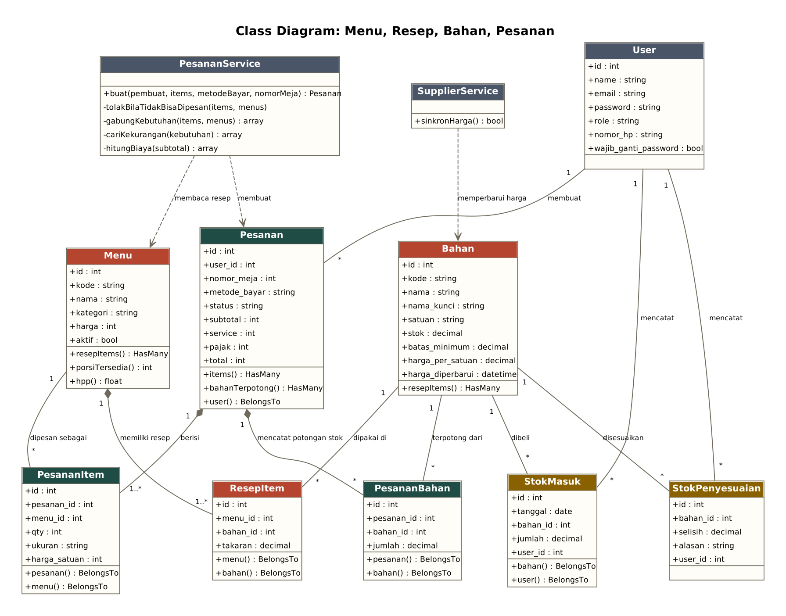
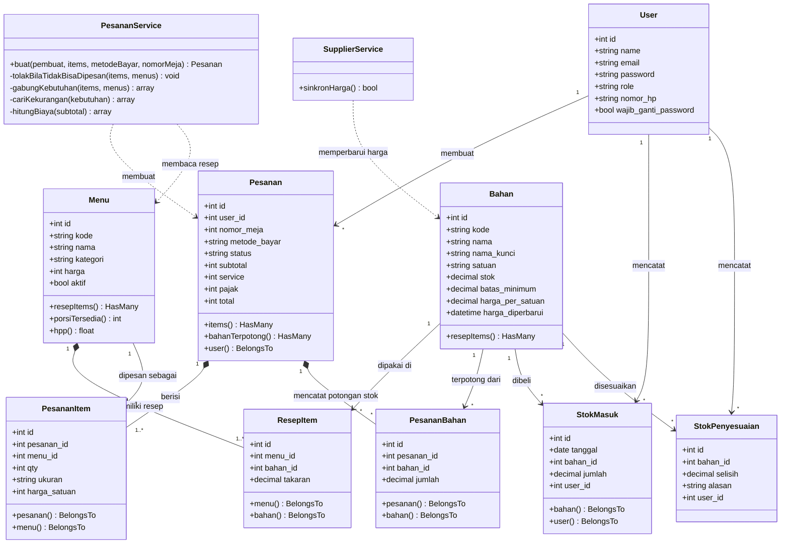

# UML Class Diagram — Menu, Resep, Bahan, Pesanan

Diagram menggambarkan hubungan kelas model (`app/Models`) dan dua layanan penting (`app/Services`).
Nama kelas mengikuti kode (bahasa Indonesia); pemetaan ke nama di rancangan awal ada di bagian bawah.

Versi teks (Mermaid, tampil otomatis di GitHub):

## Penjelasan singkat

- **Menu** terdiri dari satu atau lebih **ResepItem**. Tiap baris resep menunjuk satu **Bahan** dan takarannya.
- **Pesanan** berisi satu atau lebih **PesananItem** (menu, jumlah, ukuran, harga saat itu).
- Saat pesanan dibuat, **PesananService** menghitung kebutuhan bahan dari seluruh item, memotong stok **Bahan**, dan
  mencatat potongannya di **PesananBahan** (dipakai untuk mengembalikan stok saat batal).
- `Menu::porsiTersedia()` menghitung sisa porsi dari stok bahan (bahan paling sedikit yang menentukan); menu otomatis
  Habis bila hasilnya 0. `Menu::hpp()` menjumlahkan takaran × harga bahan per satuan dasar.
- **SupplierService** memperbarui harga bahan dari layanan Supplier; bila gagal, harga terakhir tetap dipakai.

## Pemetaan ke rancangan awal (class diagram di PDF)

| Rancangan awal | Sistem | Perubahan |
|---|---|---|
| `User` | `User` / `users` | `phone` jadi `nomor_hp`; `username` jadi `email`; `must_change_password` jadi `wajib_ganti_password`; `is_active` tidak dibuat |
| `Order` | `Pesanan` | `order_date` jadi `created_at`; status tambahan `Dibatalkan`; `user_id` wajib (pembuat) |
| `OrderDetail` | `PesananItem` | `price_at_order` jadi `harga_satuan`; ditambah `ukuran` (opsional O1) |
| `Menu` | `Menu` | `selling_price` jadi `harga`; `is_active` jadi `aktif`; tanpa `description`; ditambah `kode` |
| `Recipe` + `RecipeDetail` | `ResepItem` | Satu tabel; unik (`menu_id`, `bahan_id`); satuan mengikuti `bahan.satuan` |
| `Ingredient` | `Bahan` | `stock` jadi `stok`; `minimum_stock` jadi `batas_minimum`; `price_per_base_unit` jadi `harga_per_satuan`; ditambah `kode`, `nama_kunci` |
| `StockPurchase` + `StockPurchaseDetail` | `StokMasuk` | Satu tabel (satu pembelian = satu bahan) |
| (tidak ada) | `PesananBahan`, `StokPenyesuaian` | Ditambah: pengembalian stok presisi; opsional O3 |

| Method di rancangan awal | Letak di sistem |
|---|---|
| `calculateTotal()` | `PesananService::hitungBiaya` |
| `updateStatus()`, `cancel()` | `PesananController::ubahStatus`, `batal` |
| `canOrder()`, `checkIngredientStock()`, `calculateRequiredStock()` | `PesananService::tolakBilaTidakBisaDipesan`, `gabungKebutuhan`, `cariKekurangan` |
| `calculateHPP()` | `Menu::hpp` |
| `isLowStock()` | Pembanding `stok <= batas_minimum` di `LaporanController` dan halaman Bahan |
| `updatePrice()` | `SupplierService::sinkronHarga` |
| `increaseStock()`, `recordPurchase()` | `StokMasukController::store` |
| `resetCustomerPassword()` | `ResetPasswordController::reset` |
| `activate()`, `deactivate()` | `MenuController::ubahAktif` |

Alasan perbedaan dicatat di `docs/perancangan.md` bagian 2.
