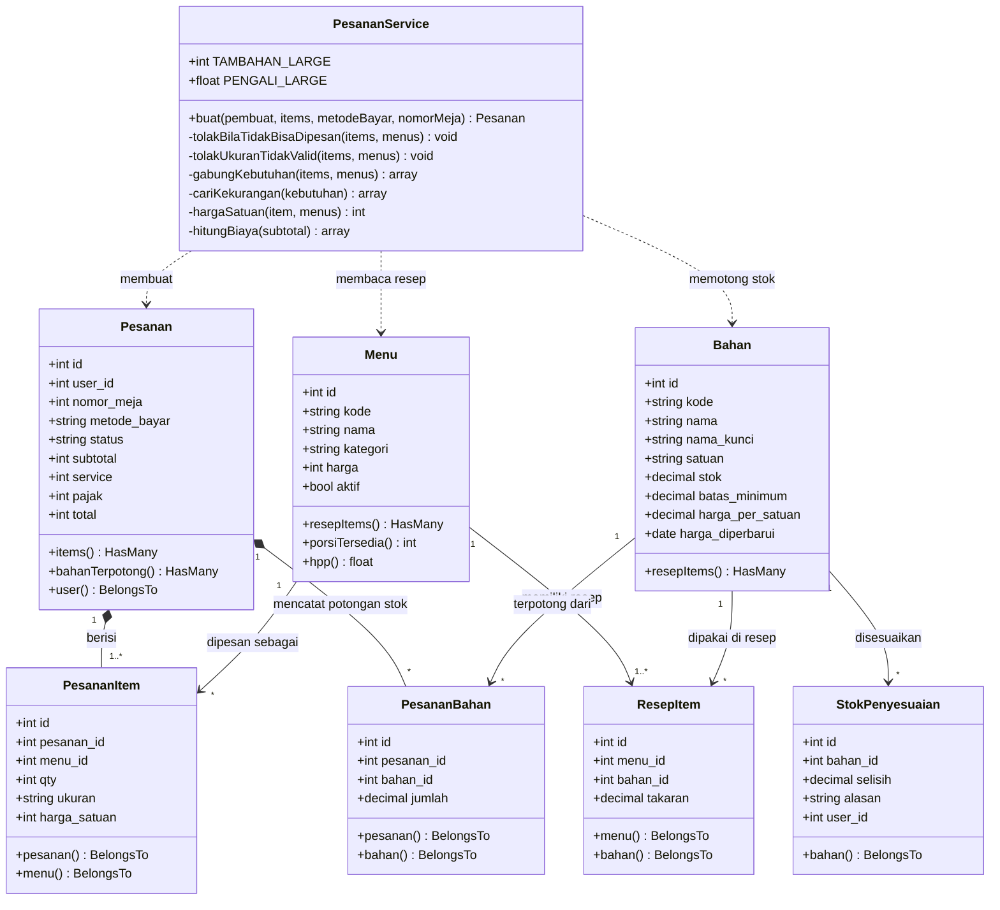

# UML Class Diagram — Menu, Resep, Bahan, Pesanan

Diagram menggambarkan hubungan kelas model (`app/Models`) dan layanan pembuat pesanan
(`app/Services/PesananService.php`). Memakai Mermaid, tampil otomatis di GitHub.

## Penjelasan singkat

- **Menu** terdiri dari satu atau lebih **ResepItem**. Tiap baris resep menunjuk satu **Bahan** dan takarannya.
- **Pesanan** berisi satu atau lebih **PesananItem** (menu, jumlah, ukuran, dan harga saat itu).
- Saat pesanan dibuat, **PesananService** menghitung kebutuhan bahan dari seluruh item (ukuran Large: takaran g dan ml
  dikali 1,5, pcs tetap), memotong stok **Bahan**, dan mencatat potongannya di **PesananBahan**.
- `Menu::porsiTersedia()` menghitung sisa porsi dari stok bahan (bahan paling sedikit yang menentukan); menu otomatis
  Habis bila hasilnya 0.
- `Menu::hpp()` menjumlahkan takaran × harga bahan per satuan dasar; margin = harga jual − HPP.
- **StokPenyesuaian** mencatat penyesuaian stok (bahan rusak atau opname) dengan alasan wajib.
